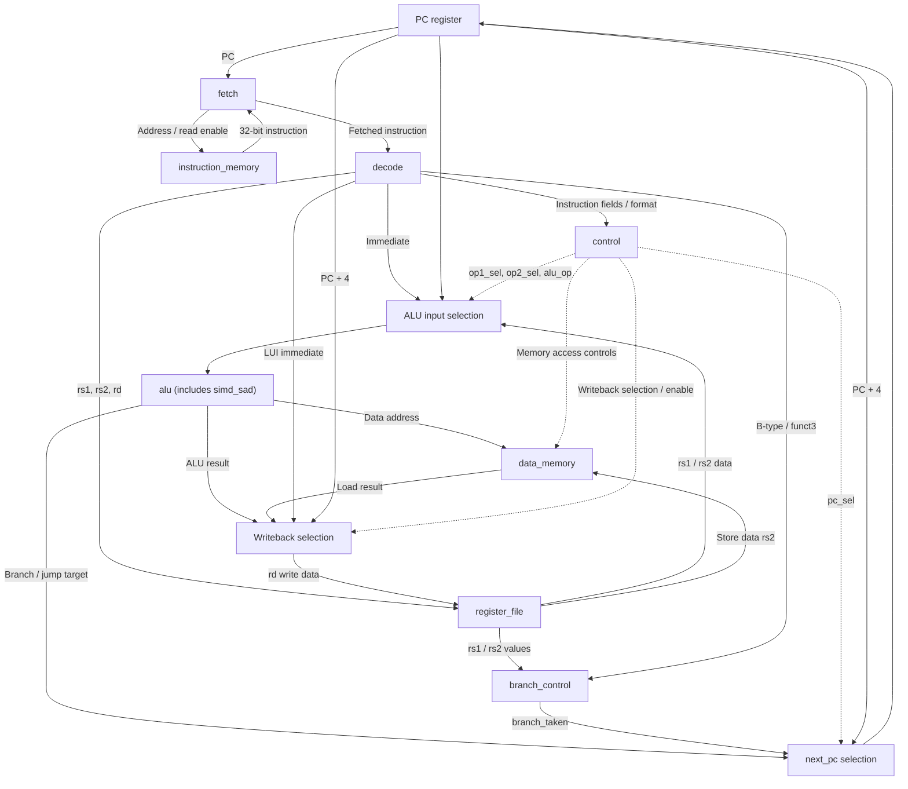
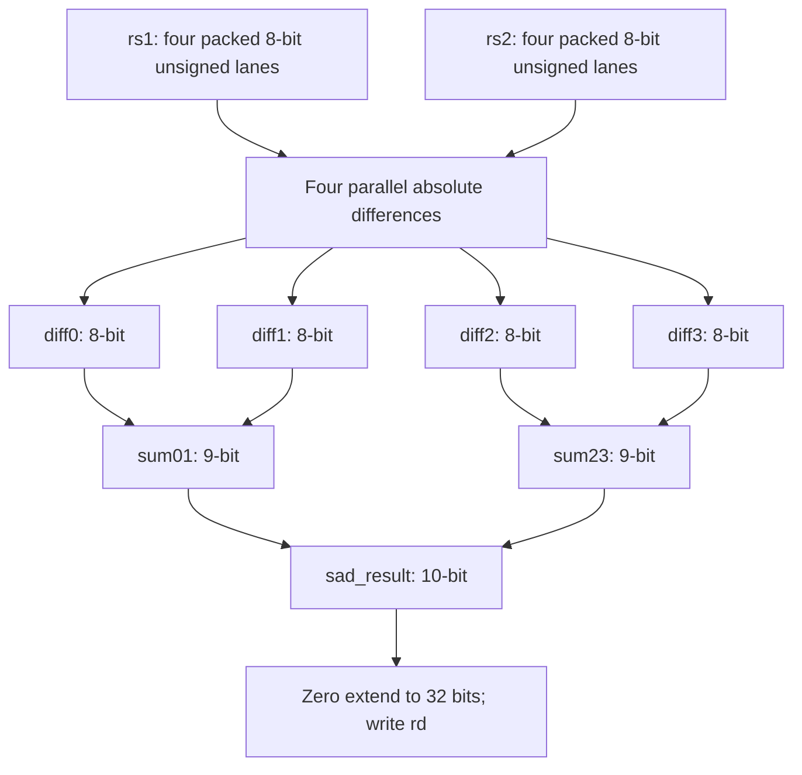

# RV32I Single-Cycle CPU with Custom SIMD SAD Instruction

A **32-bit RISC-V-based single-cycle processor** written in **SystemVerilog**, with a custom four-lane **Sum of Absolute Differences (SAD)** instruction. The repository contains the RTL, assembly test programs, machine-code memory images, and simulation testbenches.

**What this project demonstrates:** an integrated fetch/decode/execute/memory/writeback datapath, RV32I integer operations and control flow, an ALU-integrated SIMD datapath, and CPU-level functional verification in Vivado/XSim.

> **Scope:** This is an RV32I-based educational processor, **not a certified or complete RV32I implementation**. The documented integer instruction subset is implemented in the RTL; system, synchronization, exception, and privilege behavior is not implemented.

## Contents

1. [Project Overview](#1-project-overview)
2. [Processor Specifications](#2-processor-specifications)
3. [Processor Architecture](#3-processor-architecture)
4. [Instruction Execution Flow](#4-instruction-execution-flow)
5. [Supported Instructions](#5-supported-instructions)
6. [Instruction Formats and Encoding](#6-instruction-formats-and-encoding)
7. [Custom SIMD SAD Instruction](#7-custom-simd-sad-instruction)
8. [Testbenches and Verification](#8-testbenches-and-verification)
9. [SAD Performance Comparison](#9-sad-performance-comparison)
10. [Repository Structure](#10-repository-structure)
11. [Running the Simulations in Vivado](#11-running-the-simulations-in-vivado)
12. [Implementation Details and Limitations](#12-implementation-details-and-limitations)

---

## 1. Project Overview

The processor executes **32-bit instructions using a single-cycle datapath**. The instruction is fetched from an internal instruction memory, decoded, and used to select register operands, an ALU operation, optional data-memory access, and a writeback source. At the rising clock edge, the program counter and any enabled register or memory writes are updated.

There is **no pipelining**: fetch, decoding, register reads, ALU computation, memory reads, and selection of the writeback value are combinational operations within one instruction cycle. State changes occur at the clock edge.

In addition to standard integer operations, the ALU contains a separate [`simd_sad`](rtl/simd_sad.sv) unit. A custom instruction computes the sum of the absolute differences between four pairs of unsigned bytes, packed into two 32-bit registers. The project compares this one-instruction implementation with an equivalent standard RV32I assembly routine.

## 2. Processor Specifications

| Property | Actual RTL implementation |
|---|---|
| Top-level module | [`top`](rtl/top.sv), inputs `clk` and active-low `reset_n` |
| Datapath / instruction width | 32 bits / 32 bits |
| Execution model | Single-cycle, non-pipelined |
| Register file | 32 × 32-bit registers; 2 asynchronous read ports and 1 rising-edge write port |
| `x0` behavior | Writes to `x0` suppressed; all registers reset to zero on active-low reset |
| Instruction memory | Byte array, **256 bytes by default** (`ADDRESS_WIDTH = 8`) |
| Instruction fetch | Combinational read of four bytes; aligned addresses only; read disabled during reset |
| Data memory | Byte array, **64 bytes by default** (`ADDR_WIDTH = 6`) |
| Loads / stores | `LB`, `LBU`, `LH`, `LHU`, `LW`, `SB`, `SH`, `SW` |
| Byte order | Little-endian for instruction and data memory |
| Supported ISA scope | Integer arithmetic, comparisons, shifts, logical operations, upper immediates, branches, and jumps from RV32I; custom SAD |
| Custom operation | Four parallel unsigned 8-bit absolute differences and an adder tree |
| Verification files | Three SystemVerilog testbenches and their programs/results |
| Development / simulation | SystemVerilog, Vivado/XSim |

**Memory size note:** These are the module defaults in this repository, not a configurable value exposed at the `top` module's ports. The supplied sort program finishes at PC `0xE0`, within the 256-byte instruction memory.

## 3. Processor Architecture

The actual connections are defined in [`rtl/top.sv`](rtl/top.sv). The major components and their data/control dependencies are shown below.



*This is a functional wiring overview, not a pipeline or a cycle-by-cycle sequence. Some direct wires are grouped to keep the diagram readable.*

### RTL modules

| Source file | Verilog module | Role in the implemented design |
|---|---|---|
| [`rtl/top.sv`](rtl/top.sv) | `top` | PC register/next-PC logic and integration of all units; ALU input and register writeback multiplexers |
| [`rtl/fetch.sv`](rtl/fetch.sv) | `fetch` | Connects the PC to the instruction-memory address; enables fetch using `reset_n`; forwards instruction data |
| [`rtl/Instruction_Memory.sv`](rtl/Instruction_Memory.sv) | `instruction_memory` | Loads the byte-oriented program with `$readmemh` and assembles one little-endian 32-bit instruction per aligned address |
| [`rtl/Decode.sv`](rtl/Decode.sv) | `decode` | Extracts `opcode`, `funct3`, `funct7`, register indices, instruction-type flags, and sign-extended/formatted immediates |
| [`rtl/control.sv`](rtl/control.sv) | `control` | Chooses ALU operation, operand sources, data-memory controls, next-PC jump selection, and register writeback |
| [`rtl/register_file.sv`](rtl/register_file.sv) | `register_file` | 32 registers with two combinational read ports and one synchronous write port |
| [`rtl/alu.sv`](rtl/alu.sv) | `alu` | Performs arithmetic, logical, shift, compare, address calculations, and selects the SAD result |
| [`rtl/simd_sad.sv`](rtl/simd_sad.sv) | `simd_sad` | Computes four 8-bit absolute differences in parallel and sums them |
| [`rtl/branch_control.sv`](rtl/branch_control.sv) | `branch_control` | Evaluates signed/unsigned conditional branches and produces `branch_taken` |
| [`rtl/data_memory.sv`](rtl/data_memory.sv) | `data_memory` | Byte-addressable little-endian memory; combinational loads and clocked stores |
| [`rtl/rv32i_pkg.sv`](rtl/rv32i_pkg.sv) | `rv32i_pkg` | Shared opcodes, enums, memory sizes, writeback sources, control structure |

### PC and writeback selection

- Normal sequential execution: `next_pc = pc + 4`.
- Conditional branches: `branch_control` checks `rs1` and `rs2`; the **ALU separately calculates `pc + immediate`**. A taken branch selects that target.
- `JAL`: the ALU calculates `pc + immediate`; `rd` receives `pc + 4`.
- `JALR`: the ALU calculates `rs1 + immediate`; `rd` receives `pc + 4`.
- In [`top.sv`](rtl/top.sv), every selected branch/jump target has bit 0 cleared: `{alu_res[31:1], 1'b0}`.
- Register writeback can select **ALU result**, **load data**, **U-type immediate**, or **`pc + 4`**.

## 4. Instruction Execution Flow

For example, consider:

```asm
add x3, x1, x2       # x3 <- x1 + x2
```


1. **Fetch:** the PC is sent through `fetch` to `instruction_memory`, and the instruction is returned to `decode`.
2. **Decode and register read:** `decode` extracts `rs1 = x1`, `rs2 = x2`, `rd = x3`; `register_file` supplies the register values.
3. **Control:** in parallel with register reads, `control` selects `ADD`, both register operands, `WB_SRC_ALU`, and enables register writeback.
4. **Execute and select result:** the ALU computes `rs1 + rs2`; the writeback mux forwards `alu_res`.
5. **Clock edge:** `x3` receives the result and the PC advances by four bytes.

> **Important:** These are **logical data-flow steps within one instruction cycle**, not five sequential clock cycles or pipeline stages.

## 5. Supported Instructions

The four reference tables below are included in the uploaded repository under [`docs/`](docs/). The lists underneath describe the behavior **implemented in RTL**; where an illustration abbreviates a shift, immediate, or signed/unsigned comparison, the RTL semantics take precedence.

<details open>
<summary><strong>Arithmetic, comparison, and upper-immediate operations</strong></summary>


- R-type: `ADD`, `SUB`, `SLT`, `SLTU`.
- I-type: `ADDI`, `SLTI`, `SLTIU`.
- U-type: `LUI`, `AUIPC`.
- `SLT`/`SLTI` compare signed values; `SLTU`/`SLTIU` compare unsigned values. The immediate used by `SLTIU` is still **sign-extended** by the decoder.
- `LUI` writes the U-immediate directly; `AUIPC` writes `PC + U-immediate`.

</details>

<details>
<summary><strong>Logical and shift operations</strong></summary>


- R-type: `AND`, `OR`, `XOR`, `SLL`, `SRL`, `SRA`.
- I-type: `ANDI`, `ORI`, `XORI`, `SLLI`, `SRLI`, `SRAI`.
- Right shift is **logical** for `SRL`/`SRLI` (`>>`) and **arithmetic** for `SRA`/`SRAI` (`>>>` on a signed operand).
- The ALU uses only the lower **five** shift-amount bits (`alu_b[4:0]`).
- I-type immediate values are sign-extended (the shift amount still comes from the low five bits).

</details>

<details>
<summary><strong>Branch and jump operations</strong></summary>


- Branches (B-type): `BEQ`, `BNE`, `BLT`, `BGE`, `BLTU`, `BGEU`.
- `BLT`/`BGE` use **signed** comparisons; `BLTU`/`BGEU` use **unsigned** comparisons.
- A taken branch selects `PC + sign_extend(B-immediate)`; an untaken branch uses `PC + 4`.
- `JAL rd, offset` writes `PC + 4` to `rd`, then jumps by the sign-extended J-immediate.
- `JALR rd, offset(rs1)` writes `PC + 4` to `rd`, then jumps to `(rs1 + sign_extend(I-immediate)) & ~1`.

</details>

<details>
<summary><strong>Load and store operations</strong></summary>


- Loads (I-type): `LB`, `LH`, `LW`, `LBU`, `LHU`.
- Stores (S-type): `SB`, `SH`, `SW`.
- Effective byte address = `rs1 + sign_extend(immediate)`.
- `LB` and `LH` sign-extend; `LBU` and `LHU` zero-extend; `LW` returns 32 bits.
- `SB`, `SH`, and `SW` store the low 8, 16, and 32 bits of `rs2` respectively.
- **`LD`, `SD`, and `LWU` are not implemented**; they are not RV32I instructions.

</details>

## 6. Instruction Formats and Encoding

The [`decode`](rtl/Decode.sv) module identifies these standard instruction layouts and assembles the corresponding immediates:

| Format | Used for | Key fields / immediate behavior |
|---|---|---|
| **R** | Register arithmetic, logic, shifts | `funct7`, `rs2`, `rs1`, `funct3`, `rd`, `opcode` |
| **I** | Immediate ALU, loads, `JALR` | Sign-extended `instruction[31:20]` |
| **S** | Stores | Sign-extended combination of bits `[31:25]` and `[11:7]` |
| **B / SB** | Conditional branches | Sign-extended, assembled branch offset with bit 0 set to zero |
| **U** | `LUI`, `AUIPC` | Instruction bits `[31:12]` followed by 12 zeros |
| **J / UJ** | `JAL` | Sign-extended, assembled jump offset with bit 0 set to zero |

<details>
<summary><strong>Show RV32I instruction-format reference</strong></summary>


</details>

The additional `CUSTOM_0` opcode (`0x0B`) is recognized as `custom_type`. This is separate from the six standard immediate/format flags.

## 7. Custom SIMD SAD Instruction

### Operation

**SAD4** sums the absolute differences between the corresponding four **unsigned 8-bit lanes** of two 32-bit registers:

$$
\operatorname{SAD4}(A,B) = \sum_{i=0}^{3} |A_i-B_i|
$$

The actual [`simd_sad`](rtl/simd_sad.sv) datapath consists of four unsigned byte comparisons/subtractions running in parallel, followed by a two-level adder tree.



The maximum result is `4 × 255 = 1020`, requiring **10 bits** before zero extension to the CPU's 32-bit result.

### Custom instruction encoding

| Field | Value in supplied example |
|---|---|
| Assembly description | `SAD rd, rs1, rs2` (project-specific mnemonic) |
| Opcode | `CUSTOM_0 = 7'b0001011` (`0x0B`) |
| `funct3` | `000` (`CUSTOM_SAD`) |
| `rd` / `rs1` / `rs2` | Standard R-type bit positions |
| `funct7` | `0000000` in the **encoded example** |
| Actual RTL selection | `custom_type` **and** `funct3 == 000` |

**Encoding detail:** The [`control`](rtl/control.sv) module currently does **not** validate `funct7` for custom SAD. The example happens to encode `funct7 = 0000000`; this value is **not enforced by the hardware decoder**. SAD is not a standard RV32I instruction or assembler mnemonic, so the assembly file inserts the raw machine word:

```asm
lui   x1, 0x64785
addi  x1, x1, 0x032      # x1 = 0x64785032

lui   x2, 0x69766
addi  x2, x2, -204       # x2 = 0x69765F34

.word 0x0020818B        # Custom SAD: x3 <- SAD4(x1, x2)
```

See [`testbenches/assembly/SAD_Custom_Instruction.s`](testbenches/assembly/SAD_Custom_Instruction.s) for the complete example.

### Calculation for the supplied operands

| Byte lane | `x1` byte | `x2` byte | Absolute difference |
|---|---:|---:|---:|
| 0 — bits `[7:0]` | `0x32` (50) | `0x34` (52) | 2 |
| 1 — bits `[15:8]` | `0x50` (80) | `0x5F` (95) | 15 |
| 2 — bits `[23:16]` | `0x78` (120) | `0x76` (118) | 2 |
| 3 — bits `[31:24]` | `0x64` (100) | `0x69` (105) | 5 |
| **Total** | | | **24** |

In this design, [`alu.sv`](rtl/alu.sv) instantiates `simd_sad` permanently as combinational hardware and selects its output when `alu_op = SAD`.

## 8. Testbenches and Verification

The following describes the **testbenches and reference output images contained in this repository**. It is not a claim of an independently rerun simulation or a formal ISA compliance test.

### 8.1 CPU test: Bubble Sort and Statistics

- **Assembly:** [`testbenches/assembly/Sort and Statistics.s`](testbenches/assembly/Sort%20and%20Statistics.s)
- **Memory image:** [`testbenches/instruction_memory/sort_and_statistics.mem`](testbenches/instruction_memory/sort_and_statistics.mem)
- **Testbench:** [`testbenches/tb_sort_and_statistics.sv`](testbenches/tb_sort_and_statistics.sv), top `tb_sort_and_statistics`

The assembly program stores eight signed integers, sorts them in ascending order using Bubble Sort, calculates statistics, and writes the results to data memory.

| Original array | Expected sorted array |
|---|---|
| `0, -7, 18, 99, 2, -42, 51, 11` | `-42, -7, 0, 2, 11, 18, 51, 99` |

| Verified result | Value | Byte address in data memory |
|---|---:|---:|
| Minimum | -42 | `32` |
| Maximum | 99 | `36` |
| Sum | 132 | `40` |
| Strictly positive values | 5 | `44` |

The testbench watches for program initialization at PC `0x44` and its terminal self-loop at PC `0xE0`. It checks the eight memory entries, four stored results, and result registers `x22`–`x25`, calling `$fatal` on mismatch. Optional trace output is controlled by `TRACE_ENABLE`.


### 8.2 Standalone SIMD SAD test

- **RTL:** [`rtl/simd_sad.sv`](rtl/simd_sad.sv)
- **Testbench file:** [`testbenches/tb_simd_sad4.sv`](testbenches/tb_simd_sad4.sv)
- **Simulation top module:** `tb_simd_sad` (**not** `tb_simd_sad4`)

Five combinational test vectors are checked: identical bytes (0), the worked example (24), maximal opposite operands (1020 in each direction), and a mixed-input case (40). The task `check_sad4` prints `PASS` or `FAIL` for each comparison; it does **not** terminate with `$fatal` on a mismatch.

### 8.3 CPU-level SAD comparison

- **Standard program:** [`SAD_Standard.s`](testbenches/assembly/SAD_Standard.s) and [`SAD_Standard.mem`](testbenches/instruction_memory/SAD_Standard.mem)
- **Custom program:** [`SAD_Custom_Instruction.s`](testbenches/assembly/SAD_Custom_Instruction.s) and [`SAD_Custom.mem`](testbenches/instruction_memory/SAD_Custom.mem)
- **Testbench:** [`testbenches/tb_sad_cpu.sv`](testbenches/tb_sad_cpu.sv), top `tb_sad_cpu`

Set `USE_CUSTOM_SAD` in the testbench to `1'b0` for the standard implementation or `1'b1` for the custom instruction. Both load the same operands, check `x1`, `x2`, and `x3`, and print the calculation cycle count.

| Standard RV32I | Custom SAD |
|:---:|:---:|
|  |  |

**Assertion note:** `tb_sad_cpu` prints `PASS`/`FAIL` for the register/result comparison; it calls `$fatal` on its timeout, but it does **not** call `$fatal` when the result comparison fails.

## 9. SAD Performance Comparison

The CPU-level [`tb_sad_cpu`](testbenches/tb_sad_cpu.sv) counts execution cycles **only over the SAD calculation window**, after operand initialization. The two programs use different instructions but compute the same result, `24`.

| Measurement | Standard RV32I | Custom SAD instruction |
|---|---:|---:|
| Calculation PC window | `0x10` to `0x78` (dynamic flow) | `0x10` only |
| Counted execution cycles | **23** | **1** |
| Result in `x3` | **24** | **24** |

```text
Standard RV32I  | ███████████████████████  23 cycles
Custom SIMD SAD | █                        1 cycle
```

For this particular calculation, the custom instruction reduces the counted execution cycles from 23 to 1: **23× fewer cycles** (about **95.7% reduction**). The count includes the dynamically executed instructions in the selected PC interval and excludes the initial four operand-setup instructions.

> **Measurement scope:** These are simulation-based instruction/cycle counts for the tested routine. They do **not** establish FPGA clock frequency, actual elapsed-time speedup, post-synthesis timing, resource utilization, or power consumption. No such measurements are supplied in this repository.

## 10. Repository Structure

The tree below matches the **uploaded repository**, including the existing `rtl/`, `testbenches/`, and `docs/` directory structure. This updated README additionally includes the `docs/add_instruction_flow.png` illustration.

```text
RV32I-Single-Cycle-CPU-main/
├── README.md
├── rtl/
│   ├── rv32i_pkg.sv
│   ├── top.sv
│   ├── fetch.sv
│   ├── Instruction_Memory.sv
│   ├── Decode.sv
│   ├── control.sv
│   ├── register_file.sv
│   ├── alu.sv
│   ├── simd_sad.sv
│   ├── branch_control.sv
│   └── data_memory.sv
├── testbenches/
│   ├── tb_sort_and_statistics.sv
│   ├── tb_simd_sad4.sv
│   ├── tb_sad_cpu.sv
│   ├── assembly/
│   │   ├── Sort and Statistics.s
│   │   ├── SAD_Standard.s
│   │   └── SAD_Custom_Instruction.s
│   └── instruction_memory/
│       ├── sort_and_statistics.mem
│       ├── SAD_Standard.mem
│       └── SAD_Custom.mem
└── docs/
    ├── arithmetic_op.png
    ├── logical_op.png
    ├── branch_op.png
    ├── load_store.png
    ├── rv32i_encoding.png
    ├── sort_statistics_result.png
    ├── sad_standard_result.png
    ├── sad_custom_result.png
    └── add_instruction_flow.png
```

## 11. Running the Simulations in Vivado

### Prerequisites and source setup

1. Create or open a **Vivado RTL project** with an XSim-supported SystemVerilog simulation environment.
2. Add all the `.sv` files from [`rtl/`](rtl/) to **Design Sources**, with [`rv32i_pkg.sv`](rtl/rv32i_pkg.sv) compiled **before** the modules importing the package.
3. Add the desired testbench from [`testbenches/`](testbenches/) to **Simulation Sources**, then select its **simulation top module**.
4. For CPU-level tests, prepare the program memory image as explained below; use **Run Behavioral Simulation**.

### Selecting the instruction-memory image (required for CPU tests)

[`rtl/Instruction_Memory.sv`](rtl/Instruction_Memory.sv) has the following **hard-coded load statement**:

```systemverilog
initial begin
    $readmemh("instruction_memory.mem", memory);
end
```

The repository contains three differently named images under [`testbenches/instruction_memory/`](testbenches/instruction_memory/). **Selecting a testbench does not automatically select its program.** Before each CPU simulation, copy the correct existing `.mem` file and give the copy the exact name **`instruction_memory.mem`**. Make it available in the simulator's working directory (in Vivado, it can be added to Simulation Sources as a Memory Initialization File so XSim can locate it). Reload/relaunch the simulation after changing images.

The images store **bytes**, four space-separated hex bytes per source line, in the little-endian order expected by the instruction memory. They are not one 32-bit hex word per line.

| Test | Copy this source file **to** `instruction_memory.mem` | Simulation top | Other setting |
|---|---|---|---|
| Sort and Statistics | [`testbenches/instruction_memory/sort_and_statistics.mem`](testbenches/instruction_memory/sort_and_statistics.mem) | `tb_sort_and_statistics` | None (`TRACE_ENABLE=0` by default) |
| Standard SAD | [`testbenches/instruction_memory/SAD_Standard.mem`](testbenches/instruction_memory/SAD_Standard.mem) | `tb_sad_cpu` | `USE_CUSTOM_SAD = 1'b0` |
| Custom SAD | [`testbenches/instruction_memory/SAD_Custom.mem`](testbenches/instruction_memory/SAD_Custom.mem) | `tb_sad_cpu` | `USE_CUSTOM_SAD = 1'b1` |
| Standalone SIMD SAD | No instruction memory image needed | `tb_simd_sad` | Uses only `simd_sad` RTL |

For the SAD comparison, the parameter is a **localparam in the testbench file**, not a runtime command-line argument:

```systemverilog
// testbenches/tb_sad_cpu.sv
localparam bit USE_CUSTOM_SAD = 1'b1; // Custom SAD
// Change to 1'b0 for Standard RV32I SAD.
```

### What to expect

- **Sort and Statistics:** the sorted array and `MIN = -42`, `MAX = 99`, `SUM = 132`, `POSITIVE COUNT = 5`; the bench prints `PASS: SORT AND STATISTICS COMPLETED SUCCESSFULLY`.
- **Standalone SIMD SAD:** five `PASS` lines for the known vectors if all checks match.
- **Standard SAD CPU:** `SAD Result = 24`, `SAD Cycles = 23`.
- **Custom SAD CPU:** `SAD Result = 24`, `SAD Cycles = 1`, with individual lane differences `2`, `15`, `2`, and `5`.

The two CPU testbenches generate a **10 ns simulation clock**. This sets the test stimulus; it is **not** a measured synthesized Fmax.

## 12. Implementation Details and Limitations

- **Reset:** `reset_n` asynchronously clears `pc` and the register file. The instruction-memory read enable is directly gated by `reset_n` in `fetch`. Data memory has **no reset input or explicit initialization**; the test program writes its array before using it.
- **Memory accesses:** Instruction memory only supplies instructions for aligned in-range addresses, otherwise outputs `0`. Data memory is byte-addressable and little-endian, but the current RTL does **not** explicitly trap or check out-of-range/misaligned loads and stores.
- **Branching:** Conditional comparisons are performed in `branch_control`, while the ALU computes the target address. All selected control-transfer targets have their least significant bit cleared in `top`.
- **Unsupported ISA behavior:** There is no full invalid-instruction/exception mechanism, `FENCE`, `ECALL`, `EBREAK`, CSR, or privileged instruction implementation. This project should not be presented as an ISA compliance test pass.
- **Custom decode:** The custom opcode (`0x0B`) plus `funct3 == 000` selects SAD; `funct7` is not checked for that operation.
- **Verification limitations:** Sorting test uses `$fatal` on mismatches and timeout; the SAD unit test and SAD CPU functional comparison print failures without `$fatal` on mismatches (CPU timeout still uses `$fatal`). The supplied screenshots are reference simulation outputs, not measured hardware results.
- **Timing, area, power:** No FPGA synthesis resource report or timing closure result is included. Only the documented functional simulation and SAD instruction-count comparison are claimed.

---

**Summary:** This repository demonstrates a SystemVerilog RV32I-based single-cycle CPU with an ALU-integrated four-lane SIMD SAD extension, together with assembly-driven CPU tests and simulation output illustrating the reduced execution-cycle count of the custom operation.
