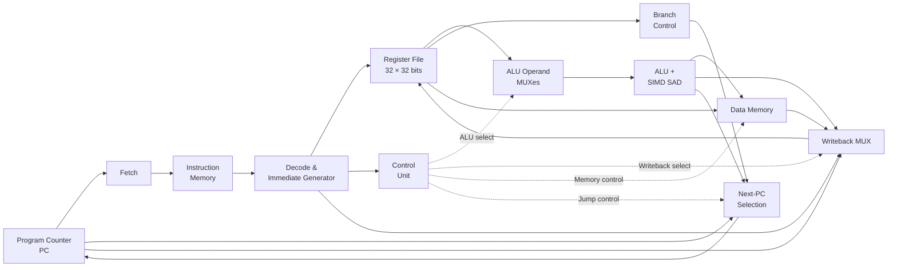
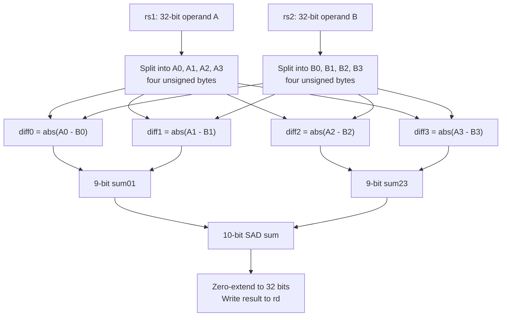

# RV32I Single-Cycle CPU with a Custom SIMD SAD Instruction

**A 32-bit RISC-V-based processor designed in SystemVerilog, featuring a single-cycle datapath, an integrated four-lane SIMD accelerator, and simulation-based verification.**

**Highlights:** 32-bit datapath · 32 general-purpose registers · RV32I arithmetic, logic, memory, and control-flow instructions · Custom `SAD` instruction · Vivado simulation testbenches

> **Project scope:** This is an educational, simulation-oriented **RV32I-based** CPU implementation with a custom extension. It implements the instruction groups documented below, but it is **not claimed to be a complete RV32I compliance implementation**. In particular, system and synchronization instructions are not implemented in the supplied RTL.

## Contents

1. [Project Overview](#1-project-overview)
2. [Key Features](#2-key-features)
3. [Processor Architecture](#3-processor-architecture)
4. [Instruction Execution Flow](#4-instruction-execution-flow)
5. [Supported Instructions](#5-supported-instructions)
6. [Instruction Formats and Encoding](#6-instruction-formats-and-encoding)
7. [Custom SIMD SAD Instruction](#7-custom-simd-sad-instruction)
8. [Simulation and Verification](#8-simulation-and-verification)
9. [Performance Comparison](#9-performance-comparison)
10. [Project Structure](#10-project-structure)
11. [How to Run](#11-how-to-run)
12. [Implementation Notes](#12-implementation-notes)

---

## 1. Project Overview

This project implements a **32-bit, single-cycle RISC-V processor** using **SystemVerilog**. The CPU fetches and decodes instructions, reads operands from its register file, executes arithmetic or logic operations, performs load/store accesses, and updates the program counter.

The processor follows a **single-cycle architecture**: the combinational datapath evaluates the active instruction between clock edges, and architectural state is updated at the clock edge. The stages described below are **logical operations within one instruction cycle**, not separate pipeline stages.

Beyond conventional RV32I instruction groups, the CPU integrates a **custom four-lane SIMD Sum of Absolute Differences (SAD)** operation in the ALU. This extension processes four unsigned 8-bit values from each 32-bit source operand in parallel and returns their sum in one CPU instruction.

The project includes assembly test programs, pre-encoded instruction memory files, and testbenches that check sorting/statistics and compare standard RV32I SAD code against the custom instruction.

## 2. Key Features

| Feature | Implementation |
|---|---|
| Architecture | 32-bit RISC-V-based, single-cycle datapath |
| RTL language | SystemVerilog |
| Register file | 32 registers × 32 bits; `x0` is always zero |
| Instruction size | 32 bits |
| Supported instruction groups | Arithmetic, comparisons, logic, shifts, loads/stores, branches, jumps, upper immediates |
| Signed/unsigned handling | `SLT`/`SLTU`, signed/unsigned branches, sign- or zero-extending loads |
| Instruction memory | Byte-addressable; 256 bytes by default |
| Data memory | Byte-addressable; 64 bytes by default |
| Byte ordering | Little-endian |
| Custom extension | `SAD` (four unsigned 8-bit lanes packed into two 32-bit operands) |
| Verification | SystemVerilog testbenches and Vivado/XSim simulation results |

## 3. Processor Architecture

The processor is divided into instruction fetch/decode, register and execution logic, memory access, and control-flow/writeback paths. The **control unit** selects ALU operations and the required sources and destinations; **branch control** evaluates conditional branches independently of the ALU's target-address calculation.



*Conceptual block diagram derived from `top.sv`. Solid links illustrate major data dependencies; dashed links show selected control dependencies. Some wiring is simplified for readability.*

### RTL Modules

| File | Module | Responsibility |
|---|---|---|
| [`top.sv`](top.sv) | `top` | Connects the datapath, control signals, memories, and PC update logic |
| [`fetch.sv`](fetch.sv) | `fetch` | Forwards the PC as an instruction-memory address and passes the fetched instruction |
| [`Instruction_Memory.sv`](Instruction_Memory.sv) | `instruction_memory` | Stores and combinationally reads byte-encoded program instructions |
| [`Decode.sv`](Decode.sv) | `decode` | Extracts instruction fields and generates format-specific immediates |
| [`control.sv`](control.sv) | `control` | Generates ALU, register writeback, data-memory, and PC control signals |
| [`register_file.sv`](register_file.sv) | `register_file` | Two combinational register read ports; one clocked write port |
| [`alu.sv`](alu.sv) | `alu` | Arithmetic, logic, comparisons, shifts, and SAD result selection |
| [`simd_sad.sv`](simd_sad.sv) | `simd_sad` | Four parallel absolute differences and an adder tree |
| [`branch_control.sv`](branch_control.sv) | `branch_control` | Signed/unsigned branch-condition evaluation |
| [`data_memory.sv`](data_memory.sv) | `data_memory` | Byte/halfword/word stores and sign-/zero-extending loads |
| [`rv32i_pkg.sv`](rv32i_pkg.sv) | `rv32i_pkg` | Shared instruction opcodes, enums, and control types |

**PC behavior:** The default next PC is `PC + 4`. For a taken branch, `JAL`, or `JALR`, the ALU provides the target address and the next-PC selection logic redirects execution. For `JALR`, the least-significant target-address bit is cleared.

## 4. Instruction Execution Flow

Consider the R-type instruction:

```asm
add x3, x1, x2    # x3 = x1 + x2
```


1. **Fetch:** The PC addresses instruction memory, which supplies the 32-bit instruction.
2. **Decode:** The decoder extracts `rs1 = x1`, `rs2 = x2`, `rd = x3`, and the instruction fields.
3. **Register read and control:** The register file supplies `x1` and `x2` while control selects an ALU addition and register writeback.
4. **Execute:** The ALU computes `x1 + x2` combinationally.
5. **State update:** At the active clock edge, the result is written to `x3` and the PC advances to `PC + 4`.

> **Single-cycle clarification:** These five numbered items explain the **flow of information**, not five clock cycles. This is **not a pipelined CPU**.

## 5. Supported Instructions

The implementation supports the RV32I instruction groups shown below. The figures summarize their assembly syntax; the RTL in [`control.sv`](control.sv) and [`alu.sv`](alu.sv) defines the actual operation selection.

<details open>
<summary><strong>Arithmetic and comparison instructions</strong></summary>


- `SLT` and `SLTI` compare **signed** values.
- `SLTU` and `SLTIU` compare **unsigned** values (the immediate operand is still sign-extended before `SLTIU` comparison).
- `LUI` and `AUIPC` are upper-immediate instructions; they are included in the arithmetic reference figure.

</details>

<details>
<summary><strong>Logical and shift instructions</strong></summary>


- `SRA` and `SRAI` perform **arithmetic** right shift, preserving the sign bit (`>>>` in the signed ALU implementation); `SRL` and `SRLI` perform **logical** right shift.
- Register-based shifts use only `rs2[4:0]` as the shift amount in RV32I.
- `ANDI`, `ORI`, and `XORI` operate on a **sign-extended** 12-bit immediate.

</details>

<details>
<summary><strong>Branch and jump instructions</strong></summary>


- `BEQ`/`BNE` compare equality, `BLT`/`BGE` perform signed comparisons, and `BLTU`/`BGEU` perform unsigned comparisons.
- Conditional branches use a **sign-extended PC-relative B-type offset** and otherwise continue at `PC + 4`.
- `JAL` writes the return address (`PC + 4`) to `rd` and jumps by a sign-extended PC-relative J-type offset.
- `JALR` writes `PC + 4` to `rd` and jumps to `(rs1 + sign_extend(imm12)) & ~1`.

</details>

<details>
<summary><strong>Load and store instructions</strong></summary>


- Loads: `LB`, `LH`, `LW`, `LBU`, `LHU` (**I-type**).
- Stores: `SB`, `SH`, `SW` (**S-type**).
- Effective address = `rs1 + sign_extend(imm12)`; `LB`/`LH` sign-extend, while `LBU`/`LHU` zero-extend.
- Doubleword load/store (`LD`/`SD`) and `LWU` are **not part of this RV32I implementation**.

</details>

## 6. Instruction Formats and Encoding

The decoder implements the six conventional 32-bit instruction formats used here:

| Format | Main fields | Typical instructions |
|---|---|---|
| **R** | `funct7`, `rs2`, `rs1`, `funct3`, `rd`, `opcode` | `ADD`, `SUB`, `AND`, `SRA` |
| **I** | 12-bit immediate, `rs1`, `funct3`, `rd`, `opcode` | `ADDI`, `LW`, `JALR` |
| **S** | Split store immediate, `rs2`, `rs1`, `funct3`, `opcode` | `SB`, `SH`, `SW` |
| **B** (SB) | Split signed branch offset, `rs2`, `rs1`, `funct3`, `opcode` | `BEQ`, `BNE`, `BLT` |
| **U** | Upper 20-bit immediate, `rd`, `opcode` | `LUI`, `AUIPC` |
| **J** (UJ) | Split signed jump offset, `rd`, `opcode` | `JAL` |

<details>
<summary><strong>Show instruction encoding reference image</strong></summary>


</details>

The decoder extracts the `opcode`, `rd`, `rs1`, `rs2`, `funct3`, and `funct7` fields and assembles the immediate according to the instruction type. The custom SAD instruction uses an **R-type-like encoding** under the `CUSTOM_0` opcode.

## 7. Custom SIMD SAD Instruction

### Why SAD?

**Sum of Absolute Differences (SAD)** is a common primitive for comparing blocks of image or video data. A standard RV32I program must extract individual byte values, calculate absolute differences, and add the results. A dedicated SIMD datapath performs the four lane calculations in parallel.

For two packed 32-bit operands `A` and `B`, each containing four unsigned 8-bit values:

$$
\mathrm{SAD4}(A,B)=\sum_{i=0}^{3}\left|A_i-B_i\right|
$$

### Four-Lane SIMD Datapath



Each absolute difference is 8 bits. Two differences sum into a 9-bit value, and the final four-lane result needs **10 bits** (maximum `4 × 255 = 1020`). The module returns that result as a zero-extended 32-bit value.

### Custom Encoding

| Field | Value |
|---|---|
| Instruction name | `SAD rd, rs1, rs2` (project-specific mnemonic) |
| Format | R-type-like custom instruction |
| `opcode` | `0001011` (`CUSTOM_0`, `0x0B`) |
| `funct3` | `000` |
| `funct7` | `0000000` for the example encoding |
| Destination | `rd` |
| Operands | `rs1`, `rs2` |

**Note:** `SAD` is **not a standard RV32I mnemonic**. It is executed through a custom instruction word in the supplied assembly program.

Example from [`SAD_Custom_Instruction.s`](SAD_Custom_Instruction.s):

```asm
lui   x1, 0x64785
addi  x1, x1, 0x032       # x1 = 0x64785032

lui   x2, 0x69766
addi  x2, x2, -204        # x2 = 0x69765F34

# Custom SAD x3, x1, x2
.word 0x0020818B         # opcode = 0x0B, funct3 = 000

# Expected: x3 = 24
```

### Example Calculation

| Lane | A byte | B byte | Absolute difference |
|---|---:|---:|---:|
| 0 (bits 7:0) | `0x32` (50) | `0x34` (52) | 2 |
| 1 (bits 15:8) | `0x50` (80) | `0x5F` (95) | 15 |
| 2 (bits 23:16) | `0x78` (120) | `0x76` (118) | 2 |
| 3 (bits 31:24) | `0x64` (100) | `0x69` (105) | 5 |
| **Total SAD** | | | **24** |

The [`alu.sv`](alu.sv) module instantiates [`simd_sad.sv`](simd_sad.sv). The control unit selects the `SAD` ALU operation when it decodes the custom opcode and `funct3` combination.

## 8. Simulation and Verification

The repository contains three testbench files. All reported results in this section come from the **provided simulation outputs**, not from FPGA timing or hardware measurements.

### 8.1 Sort and Statistics — CPU Functional Test

**Source:** [`Sort and Statistics.s`](Sort%20and%20Statistics.s)  
**Program image:** [`sort_and_statistics.mem`](sort_and_statistics.mem)  
**Testbench:** [`tb_sort_and_statistics.sv`](tb_sort_and_statistics.sv)

The program initializes eight signed integers in data memory, performs an ascending **Bubble Sort**, then calculates and stores minimum, maximum, sum, and the number of strictly positive values.

| Original array | Sorted array |
|---|---|
| `0, -7, 18, 99, 2, -42, 51, 11` | `-42, -7, 0, 2, 11, 18, 51, 99` |

| Statistic | Verified value | Data memory byte address |
|---|---:|---:|
| Minimum | -42 | 32 |
| Maximum | 99 | 36 |
| Sum | 132 | 40 |
| Positive count | 5 | 44 |

The testbench compares the sorted values and statistics with expected results and uses `$fatal` if a checked value is incorrect.


### 8.2 SIMD SAD Unit Test

**RTL:** [`simd_sad.sv`](simd_sad.sv)  
**Testbench file:** [`tb_simd_sad4.sv`](tb_simd_sad4.sv)  
**Testbench module name:** `tb_simd_sad`

The combinational SIMD module is tested independently with five input patterns:

| Test | Expected SAD |
|---|---:|
| Identical packed operands | 0 |
| Known example | 24 |
| `0xFFFFFFFF` against `0x00000000` | 1020 |
| Reversed maximum difference | 1020 |
| Mixed input values | 40 |

The testbench prints `PASS`/`FAIL` for each case; unlike the sorting testbench, its individual mismatches are **reported via `$display` rather than `$fatal`**.

### 8.3 SAD on the Complete CPU

**Programs:** [`SAD_Standard.s`](SAD_Standard.s) and [`SAD_Custom_Instruction.s`](SAD_Custom_Instruction.s)  
**Program images:** [`SAD_Standard.mem`](SAD_Standard.mem) and [`SAD_Custom.mem`](SAD_Custom.mem)  
**Testbench:** [`tb_sad_cpu.sv`](tb_sad_cpu.sv)

Both versions initialize the same operands in `x1` and `x2`, calculate SAD, and check that `x3 == 24`. The testbench also prints the count of executed instructions within the configured SAD calculation window.

| Standard RV32I result | Custom SAD result |
|:---:|:---:|
|  |  |

## 9. Performance Comparison

The provided CPU-level SAD testbench measures the **SAD calculation portion only**, after the two source registers have been initialized. It counts executed instructions within the selected PC range; on a single-cycle CPU, each executed instruction corresponds to one clock cycle.

| Metric | Standard RV32I | Custom SAD |
|---|---:|---:|
| Calculation cycles | **23** | **1** |
| SAD result | 24 | 24 |
| Implementation | Multiple standard instructions | One custom instruction |

**For this test case, the custom SAD implementation uses 23× fewer calculation cycles** (approximately **95.7% fewer cycles**).

```text
Standard RV32I   | ███████████████████████  23 cycles
Custom SAD       | █                       1 cycle
```

**Measurement boundary:** These counts exclude the initial operand-loading instructions. They demonstrate an **instruction/cycle-count reduction for this example**, not a measured increase in clock frequency, full-program speedup, FPGA Fmax, area efficiency, or power efficiency.

## 10. Project Structure

```text
RV32I-Single-Cycle-CPU/
├── README.md
├── rv32i_pkg.sv
├── top.sv
├── fetch.sv
├── Instruction_Memory.sv
├── Decode.sv
├── control.sv
├── register_file.sv
├── alu.sv
├── simd_sad.sv
├── branch_control.sv
├── data_memory.sv
│
├── Sort and Statistics.s
├── sort_and_statistics.mem
├── SAD_Standard.s
├── SAD_Standard.mem
├── SAD_Custom_Instruction.s
├── SAD_Custom.mem
│
├── tb_sort_and_statistics.sv
├── tb_simd_sad4.sv
├── tb_sad_cpu.sv
│
└── docs/
    └── images/
        ├── arithmetic_operations.png
        ├── logical_operations.png
        ├── branching_operations.png
        ├── load_store_operations.png
        ├── rv32i_encoding_reference.png
        ├── add_instruction_flow.png
        ├── sort_statistics_result.png
        ├── sad_standard_result.png
        └── sad_custom_result.png
```

The directory tree above represents the **recommended GitHub layout**. The `docs/images/` folder is supplied alongside this README as a separate asset bundle; add it to the RTL repository so the relative image links work.

## 11. How to Run

### Prerequisites

- AMD Vivado with the XSim simulator (the project sources were developed for Vivado/SystemVerilog).
- All `.sv` source files, the selected testbench, and the corresponding `.mem` instruction image.

### 11.1 Prepare the RTL Project

1. Create or open an **RTL project** in Vivado.
2. Add all processor/SystemVerilog design sources. Ensure **`rv32i_pkg.sv` is compiled before modules that import it**.
3. Add the desired testbench under **Simulation Sources**.
4. Choose the appropriate **simulation top module**, as specified below.
5. Launch **Run Behavioral Simulation**.

> **Instruction-memory filename:** `Instruction_Memory.sv` currently executes `$readmemh("instruction_memory.mem", memory);`. Before running a CPU-level test, copy the relevant program image to **`instruction_memory.mem`**, and ensure Vivado/XSim can locate it in its simulation working directory (for example, include that file in the simulation sources). Merely keeping a differently named `.mem` file in the repository will not select it.

### 11.2 Sort and Statistics

1. Copy `sort_and_statistics.mem` to `instruction_memory.mem` (preserve the original file).
2. Set simulation top to **`tb_sort_and_statistics`**.
3. Run the simulation. Expect the eight values to be sorted, the four statistics to match the table above, and a final `PASS` message.

### 11.3 Standalone SIMD SAD

1. Set simulation top to **`tb_simd_sad`**. This module is declared inside `tb_simd_sad4.sv`.
2. Run the testbench; no CPU instruction-memory image is required.
3. Inspect the five printed `PASS`/`FAIL` results.

### 11.4 Standard RV32I SAD

1. Copy `SAD_Standard.mem` to `instruction_memory.mem`.
2. In `tb_sad_cpu.sv`, set `localparam bit USE_CUSTOM_SAD = 1'b0;`.
3. Set simulation top to **`tb_sad_cpu`**.
4. Run the simulation. The supplied reference result is `SAD Result = 24`, `SAD Cycles = 23`.

### 11.5 Custom SAD Instruction

1. Copy `SAD_Custom.mem` to `instruction_memory.mem`.
2. In `tb_sad_cpu.sv`, set `localparam bit USE_CUSTOM_SAD = 1'b1;`.
3. Set simulation top to **`tb_sad_cpu`**.
4. Run the simulation. The supplied reference result is `SAD Result = 24`, `SAD Cycles = 1`.

**Tip:** When switching programs, make sure the simulator loads the **new** `instruction_memory.mem` file; restart or relaunch the behavioral simulation if necessary.

## 12. Implementation Notes

- **Combinational reads / clocked writes:** Instruction memory is read combinationally; the register file reads combinationally and writes at the positive clock edge. Data-memory loads are combinational; stores are clocked.
- **Reset:** The PC and register file use an active-low `reset_n` signal. The provided testbenches use a 10 ns clock period (a **simulation stimulus**, not a demonstrated maximum operating frequency).
- **Memory sizes:** Default instruction memory is 256 bytes (`ADDRESS_WIDTH = 8`); default data memory is 64 bytes (`ADDR_WIDTH = 6`). These defaults are defined in the corresponding RTL modules.
- **Memory representation:** Instruction images contain byte values in little-endian order, matching the instruction-memory assembly logic. Data memory is also byte-addressable and little-endian.
- **No pipeline:** The design does not include separate pipelined fetch, decode, execute, memory, and writeback registers.
- **Instruction coverage:** This is a practical RV32I-based subset plus a custom instruction, **not** a complete implementation of all base-ISA/system/synchronization behavior.
- **Custom encoding scope:** The provided control decoder selects SAD from `CUSTOM_0` and `funct3 = 000`; the supplied `.word` example uses `funct7 = 0000000`. Other custom-encoding validation rules are not claimed.
- **Verification scope:** The included tests cover the documented programs and SAD unit examples; they are not a formal ISA compliance suite.

---

**Summary:** The project demonstrates how a compact single-cycle processor can execute RV32I-style assembly programs and how a dedicated SIMD datapath can reduce the number of instructions needed for a targeted computation.
