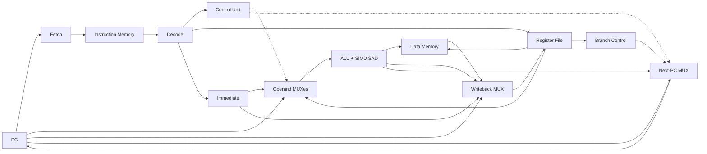
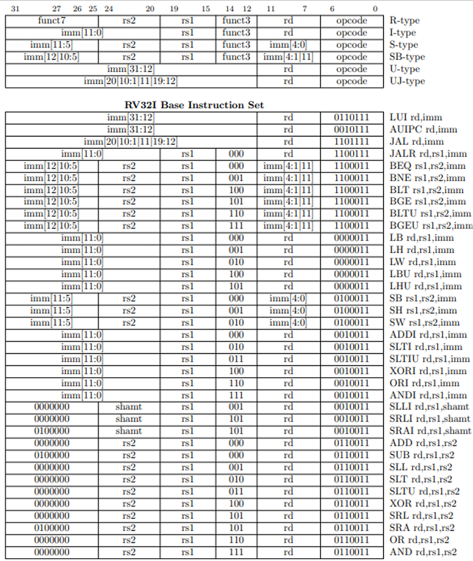
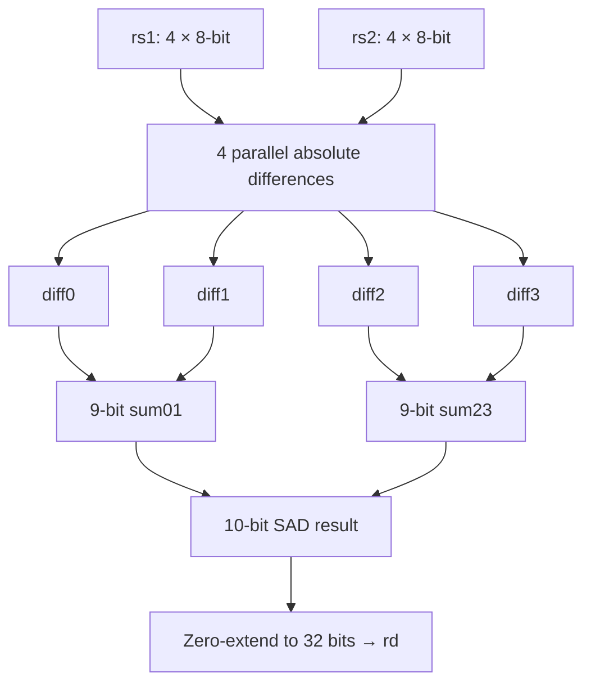

# RV32I Single-Cycle CPU

This project implements a **32-bit RISC-V processor** using **SystemVerilog**, based on the RV32I instruction set architecture.

The processor uses a **single-cycle architecture**, where each instruction is executed within a single clock cycle. The instruction is processed between clock edges, and the results are stored at the next rising edge.

In addition to the supported RV32I instructions, the processor integrates a **custom four-lane SIMD Sum of Absolute Differences (SAD) instruction**, implemented as a dedicated hardware unit within the ALU.

The project includes RISC-V assembly programs, pre-encoded instruction memory files, and SystemVerilog testbenches for functional verification, including sorting, statistical calculations, and a comparison between standard RV32I instructions and the custom SAD implementation.

## Key Features

| Feature | Implementation |
|---|---|
| Architecture | 32-bit RISC-V-based, single-cycle datapath |
| RTL language | SystemVerilog |
| Register file | 32 registers × 32 bits; `x0` is always zero |
| Instruction size | 32 bits |
| Supported instruction groups | Arithmetic, comparisons, logic, shifts, loads/stores, branches, jumps, upper immediates |
| Instruction memory |  Byte-addressable, parameterizable size; 256 bytes by default |
| Data memory | Byte-addressable, parameterizable size; 64 bytes by default  |
| Byte ordering | Little-endian |
| Custom extension | Four-lane SIMD SAD instruction |
---

## Processor Architecture

The design is centered on [`rtl/top.sv`](rtl/top.sv), which connects the functional blocks and updates the program counter (`PC`). The **datapath is not pipelined**: instruction fetch, decode, register reads, ALU operations, and optional memory reads form a combinational path; the PC, register writes, and memory stores update on the rising clock edge.



*Functional overview based on `top.sv`. Some control signals and direct connections are omitted for readability.*


### RTL modules

| Module | Implementation role |
|---|---|
| [`top.sv`](rtl/top.sv) | Integrates the datapath; implements PC update, operand and writeback selection |
| [`fetch.sv`](rtl/fetch.sv) · [`Instruction_Memory.sv`](rtl/Instruction_Memory.sv) | Instruction fetch and byte-oriented program memory |
| [`Decode.sv`](rtl/Decode.sv) · [`control.sv`](rtl/control.sv) | Instruction formats, immediates, and control signals |
| [`register_file.sv`](rtl/register_file.sv) | 32 registers, two read ports, one synchronous write port; `x0` is zero |
| [`alu.sv`](rtl/alu.sv) · [`simd_sad.sv`](rtl/simd_sad.sv) | Integer ALU plus four parallel SAD lanes |
| [`branch_control.sv`](rtl/branch_control.sv) | Signed and unsigned branch-condition checks |
| [`data_memory.sv`](rtl/data_memory.sv) | Little-endian byte, halfword, and word loads/stores |
| [`rv32i_pkg.sv`](rtl/rv32i_pkg.sv) | Shared opcode, ALU-operation, memory-size, and writeback types |

**Memory defaults:** 256-byte instruction memory and 64-byte data memory; both are byte-addressable and little-endian. These are the parameter defaults in the provided RTL.

---

## Instruction Set

### Instruction Encoding

The processor decodes the six instruction formats **R, I, S, B (SB), U, and J (UJ)**. The diagram below is the repository's original [`rv32i_encoding.png`](docs/rv32i_encoding.png), shown directly rather than hidden in a collapsed section.

<p align="center">
  <a href="docs/rv32i_encoding.png"></a>
</p>

The [`decode`](rtl/Decode.sv) module extracts `opcode`, `rd`, `rs1`, `rs2`, `funct3`, and `funct7`, then builds the selected immediate (with sign extension and low-bit placement as needed). The additional `CUSTOM_0` opcode identifies the project-specific SAD format.

### Supported Instructions

The tables provide a visual overview of the integer instructions implemented in this CPU. Click a table to see it at full resolution.

| Arithmetic & comparisons | Logical operations & shifts |
|:---:|:---:|
| [](docs/arithmetic_op.png) | [](docs/logical_op.png) |
| **Branching & jumps** | **Load / store** |
| [](docs/branch_op.png) | [](docs/load_store.png) |

| Category | Implemented mnemonics |
|---|---|
| Arithmetic and comparisons | `ADD`, `SUB`, `ADDI`, `SLT`, `SLTU`, `SLTI`, `SLTIU`, `LUI`, `AUIPC` |
| Logic and shifts | `AND`, `OR`, `XOR`, `ANDI`, `ORI`, `XORI`, `SLL`, `SRL`, `SRA`, `SLLI`, `SRLI`, `SRAI` |
| Branches and jumps | `BEQ`, `BNE`, `BLT`, `BGE`, `BLTU`, `BGEU`, `JAL`, `JALR` |
| Loads and stores | `LB`, `LBU`, `LH`, `LHU`, `LW`, `SB`, `SH`, `SW` |

**Behavior notes:** `SRA`/`SRAI` are arithmetic right shifts; register shifts use the low five bits of the shift amount. `BLT`/`BGE` are signed comparisons, while `BLTU`/`BGEU` are unsigned. `LB`/`LH` sign-extend; `LBU`/`LHU` zero-extend. `LD`, `SD`, and `LWU` are **not** RV32I instructions and are **not** implemented here. Where a reference-table illustration abbreviates an operation, the RTL is authoritative.

---

## Custom SIMD SAD Instruction

The custom instruction accelerates **Sum of Absolute Differences (SAD)**, a building block used in image comparison, block matching, and motion estimation.

Two 32-bit registers contain four **unsigned 8-bit values** each. The hardware computes their four absolute differences **in parallel** and sums them:

$$
\mathrm{SAD4}(A,B)=\sum_{i=0}^{3}|A_i-B_i|
$$



The maximum SAD value is **1020** (`4 × 255`), so the internal sum uses 10 bits before being zero-extended to the 32-bit destination.

### Custom encoding and example

The instruction uses the **`CUSTOM_0` opcode (`0x0B`)**, `funct3 = 000`, and the ordinary `rd`/`rs1`/`rs2` register fields. In the supplied encoded example, `funct7 = 0000000`; the current control logic selects SAD from the custom opcode and `funct3`, **without checking `funct7`**.

```asm
lui   x1, 0x64785
addi  x1, x1, 0x032     # x1 = 0x64785032

lui   x2, 0x69766
addi  x2, x2, -204      # x2 = 0x69765F34

.word 0x0020818B       # SAD x3, x1, x2 (custom encoding)
```

From the corresponding byte pairs, the differences are `2`, `15`, `2`, and `5`, giving **SAD = 24**. See the full [`custom assembly program`](testbenches/assembly/SAD_Custom_Instruction.s) and [`simd_sad.sv`](rtl/simd_sad.sv).

---

## Simulation and Verification

The repository provides three SystemVerilog testbenches and saved XSim console-output images. The screenshots below are **results supplied with the project**; the RTL has not been independently re-simulated for this README.

### 1. Bubble Sort and Statistics — CPU test

[`tb_sort_and_statistics.sv`](testbenches/tb_sort_and_statistics.sv) executes the [`Sort and Statistics.s`](testbenches/assembly/Sort%20and%20Statistics.s) program. It writes eight integers to data memory, sorts them in ascending order, then checks the stored array, computed statistics, and result registers.

| Test | Expected value |
|---|---|
| Sorted array | `[-42, -7, 0, 2, 11, 18, 51, 99]` |
| Minimum / maximum | `-42` / `99` |
| Sum | `132` |
| Positive count | `5` |

<p align="center">
  <a href="docs/sort_statistics_result.png"></a>
</p>

### 2. SIMD SAD4 — standalone unit test

[`tb_simd_sad4.sv`](testbenches/tb_simd_sad4.sv) contains the simulation top module **`tb_simd_sad`**. It exercises five cases: equal operands, the worked example, two maximum-difference orders, and a mixed-byte example. Expected results: `0`, `24`, `1020`, `1020`, and `40`. The test prints `PASS`/`FAIL` for each vector.

### 3. SAD on the full CPU — standard vs. custom

[`tb_sad_cpu.sv`](testbenches/tb_sad_cpu.sv) uses the same input operands for both programs and checks that `x3 = 24`. Its `USE_CUSTOM_SAD` local parameter selects the corresponding PC measurement window; the **program memory image must also be selected separately**.

| Standard RV32I assembly | Custom SAD instruction |
|:---:|:---:|
| [](docs/sad_standard_result.png) | [](docs/sad_custom_result.png) |
| **23 calculation cycles** | **1 calculation cycle** |

The custom implementation uses **23× fewer counted instruction cycles** for this test's SAD calculation (approximately **95.7% fewer cycles**). Both produce a result of `24`.

> **Measurement scope:** The testbench counts the SAD routine's dynamic instruction cycles, excluding operand initialization. This is **not** a measured FPGA frequency, elapsed-time benchmark, synthesis result, or power comparison. The SAD CPU test prints `PASS`/`FAIL` on result mismatch (with `$fatal` for timeout); the standalone SAD unit test also prints `PASS`/`FAIL`. The sorting test uses `$fatal` for failed checks.

---

## Running the Project

**Environment:** A Vivado project with XSim and SystemVerilog support. These instructions describe simulation, not a board programming flow.

1. Add all files in [`rtl/`](rtl/) to **Design Sources**. Ensure [`rv32i_pkg.sv`](rtl/rv32i_pkg.sv) is compiled before modules that import it.
2. Add the testbench of interest from [`testbenches/`](testbenches/) to **Simulation Sources** and select its **actual module name** as the simulation top.
3. For a CPU test, choose the matching image below. [`Instruction_Memory.sv`](rtl/Instruction_Memory.sv) calls `$readmemh("instruction_memory.mem", memory)` — a filename that is **not supplied directly** in the repository. Copy the selected `.mem` file under that exact name and make it available in XSim's simulation working directory (for example as a Vivado memory initialization source).
4. For the SAD CPU comparison, also set `USE_CUSTOM_SAD` in [`tb_sad_cpu.sv`](testbenches/tb_sad_cpu.sv) to the matching value. **Relaunch the simulation** after switching programs.
5. Run **Behavioral Simulation** and inspect the XSim console output.

| Test | Simulation top | Memory image | Testbench setting |
|---|---|---|---|
| Sort & statistics | `tb_sort_and_statistics` | [`sort_and_statistics.mem`](testbenches/instruction_memory/sort_and_statistics.mem) | none |
| Standalone SIMD | `tb_simd_sad` | **Not required** | none |
| Standard SAD on CPU | `tb_sad_cpu` | [`SAD_Standard.mem`](testbenches/instruction_memory/SAD_Standard.mem) | `USE_CUSTOM_SAD = 1'b0` |
| Custom SAD on CPU | `tb_sad_cpu` | [`SAD_Custom.mem`](testbenches/instruction_memory/SAD_Custom.mem) | `USE_CUSTOM_SAD = 1'b1` |

> **Important:** The testbench selection **does not automatically change** which `.mem` file `$readmemh` loads. All supplied images contain byte values in little-endian order, one byte per memory entry.

---

## Repository Structure

```text
RV32I-Single-Cycle-CPU/
├── README.md
├── rtl/
│   ├── top.sv                  # Processor integration
│   ├── rv32i_pkg.sv            # Shared types and opcodes
│   ├── fetch.sv
│   ├── Instruction_Memory.sv
│   ├── Decode.sv
│   ├── control.sv
│   ├── register_file.sv
│   ├── alu.sv
│   ├── simd_sad.sv
│   ├── branch_control.sv
│   └── data_memory.sv
├── testbenches/
│   ├── tb_sort_and_statistics.sv
│   ├── tb_simd_sad4.sv
│   ├── tb_sad_cpu.sv
│   ├── assembly/               # Three source programs (.s)
│   └── instruction_memory/     # Three byte-oriented images (.mem)
└── docs/
    ├── rv32i_encoding.png     # Instruction formats and encoding
    ├── arithmetic_op.png
    ├── logical_op.png
    ├── branch_op.png
    ├── load_store.png
    ├── add_instruction_flow.png
    ├── sort_statistics_result.png
    ├── sad_standard_result.png
    └── sad_custom_result.png
```

### How an instruction executes

The following example shows `ADD x3, x1, x2` passing through the CPU. **The diagram describes logical data flow, not separate clock cycles.**


- **Fetch & decode:** instruction memory supplies the 32-bit instruction; `decode` extracts its operands and fields.
- **Execute:** register values from `x1` and `x2` feed the ALU; the control unit selects addition.
- **Writeback & PC:** on the rising edge, `x3` receives the sum and the PC advances by four bytes.
**Scope and limitations:** This is an **RV32I-based educational implementation**, not a complete ISA-compliance-certified RISC-V processor. The source supports the documented integer subset and custom SAD operation; it does not implement system/CSR instructions, traps/exceptions, `FENCE`, or privilege modes. Alignment/out-of-range memory accesses are not handled through a trap mechanism. The repository demonstrates RTL behavior and simulation, **not** post-synthesis timing or FPGA resource utilization.
