# RV32I Single-Cycle CPU

This project implements a **32-bit RISC-V processor** using **SystemVerilog**, based on the RV32I instruction set architecture.

The processor uses a **single-cycle architecture**, where each instruction is executed within a single clock cycle. The instruction is processed between clock edges, and the results are stored at the next rising edge.

In addition to the supported RV32I instructions, the processor integrates a **custom four-lane SIMD Sum of Absolute Differences (SAD) instruction**, implemented as a dedicated hardware unit within the ALU.

The project includes RISC-V assembly programs, pre-encoded instruction memory files, and SystemVerilog testbenches for functional verification, including sorting, statistical calculations, and a comparison between standard RV32I instructions and the custom SAD implementation.

## Key Features

| Feature | Implementation |
|---|---|
| Architecture | 32-bit RISC-V-based, single-cycle datapath |
| RTL language | SystemVerilog |
| Register file | 32 registers × 32 bits; `x0` is always zero |
| Instruction size | 32 bits |
| Supported instruction groups | Arithmetic, comparisons, logic, shifts, loads/stores, branches, jumps, upper immediates |
| Instruction memory |  Byte-addressable, parameterizable size; 256 bytes by default |
| Data memory | Byte-addressable, parameterizable size; 64 bytes by default  |
| Byte ordering | Little-endian |
| Custom Instruction Support | Extensible architecture supporting custom RISC-V instructions |

## Processor Architecture

The processor is implemented as a **single-cycle datapath**, with its main components integrated in `top.sv`.

During each clock cycle, the processor fetches an instruction, decodes it, reads the required operands, performs the operation, and determines the next program counter (`PC`). Depending on the instruction, the result may be written to the register file or stored in data memory.

The processor uses **combinational logic** to execute instructions within each clock cycle, while **sequential logic** updates the architectural state at the rising clock edge.


### Architecture Overview

The following diagram illustrates the datapath and control architecture of the RV32I single-cycle processor, including instruction fetch, decoding, register file, ALU, memory access, branch control, and writeback.

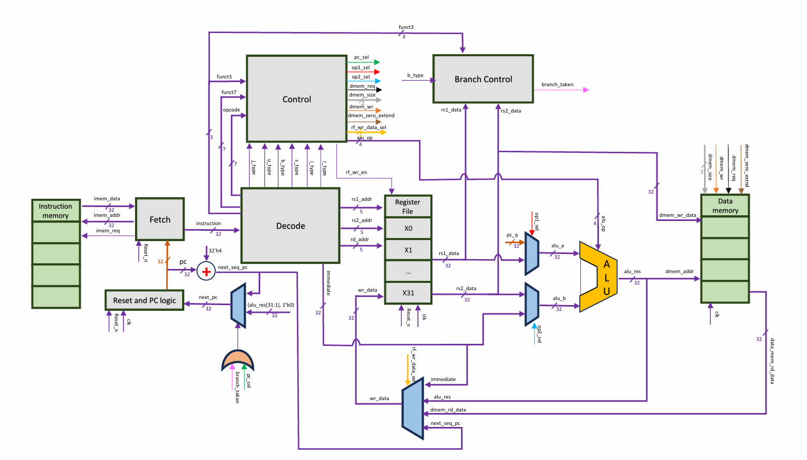


### RTL Modules

The processor is organized into modular SystemVerilog components, each responsible for a specific function within the datapath or control logic.

| Module | Description |
|---|---|
| [`top.sv`](rtl/top.sv) | Top-level integration of the processor, including datapath connections, multiplexers, and PC updates |
| [`fetch.sv`](rtl/fetch.sv) | Manages instruction fetching and interfaces with instruction memory |
| [`Instruction_Memory.sv`](rtl/Instruction_Memory.sv) | Stores program instructions and provides the instruction corresponding to the current PC |
| [`Decode.sv`](rtl/Decode.sv) | Decodes instruction fields, identifies instruction formats, and generates immediate values |
| [`control.sv`](rtl/control.sv) | Generates control signals for ALU operations, memory access, register writeback, and PC selection |
| [`register_file.sv`](rtl/register_file.sv) | Implements 32 general-purpose registers with two asynchronous read ports and one synchronous write port |
| [`alu.sv`](rtl/alu.sv) | Performs arithmetic, logical, comparison, shift, and custom SAD operations |
| [`simd_sad.sv`](rtl/simd_sad.sv) | Implements the custom four-lane SIMD SAD computation |
| [`branch_control.sv`](rtl/branch_control.sv) | Evaluates branch conditions using signed and unsigned comparisons |
| [`data_memory.sv`](rtl/data_memory.sv) | Supports byte, halfword, and word memory accesses |
| [`rv32i_pkg.sv`](rtl/rv32i_pkg.sv) | Defines shared instruction opcodes, operation types, and control enumerations |


## Instruction Set

### Instruction Encoding

The processor supports six standard RV32I instruction formats: **R, I, S, B (SB), U, and J (UJ)**, along with **custom instructions** using the `CUSTOM_0` opcode (`0x0B`), allowing future instruction set extensions.

Each instruction is 32 bits wide and contains fields such as the opcode, register addresses, function codes, and immediate values.

The following diagram illustrates the instruction formats and their binary encodings, including the custom SAD4 instruction.

<p align="center">
  <a href="docs/rv32i_encoding.jpg">
    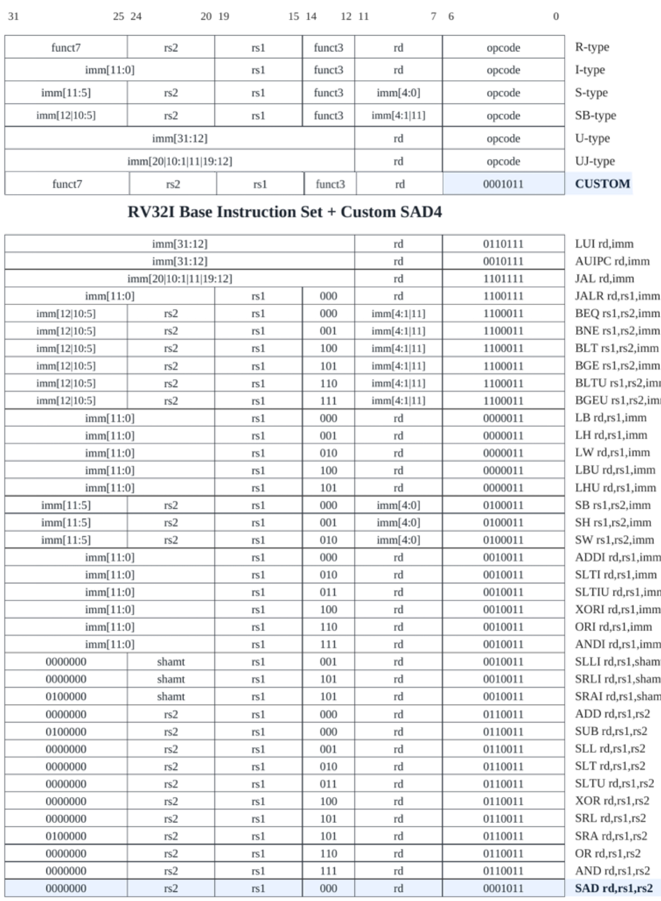
  </a>
</p>

The `Decode` module extracts `opcode`, `rd`, `rs1`, `rs2`, `funct3`,`funct7` and generates the corresponding 32-bit immediate value.

### Supported Instructions

The processor supports arithmetic, logical operations, shifts, branches, jumps, and memory access instructions. The following diagrams provide a visual reference of the supported instructions, organized into four categories:

| Arithmetic & Comparisons | Logical Operations & Shifts |
|:---:|:---:|
| [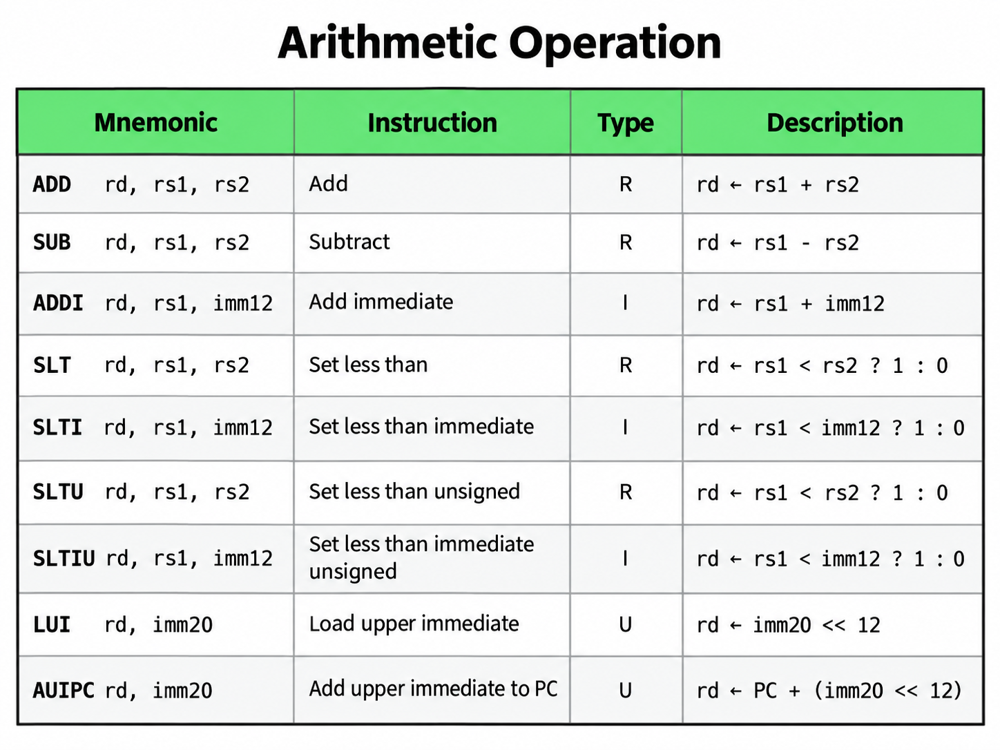](docs/arithmetic_op.png) | [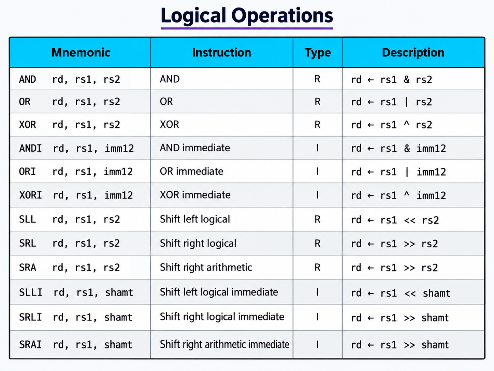](docs/logical_op.png) |
| **Branches & Jumps** | **Load & Store** |
| [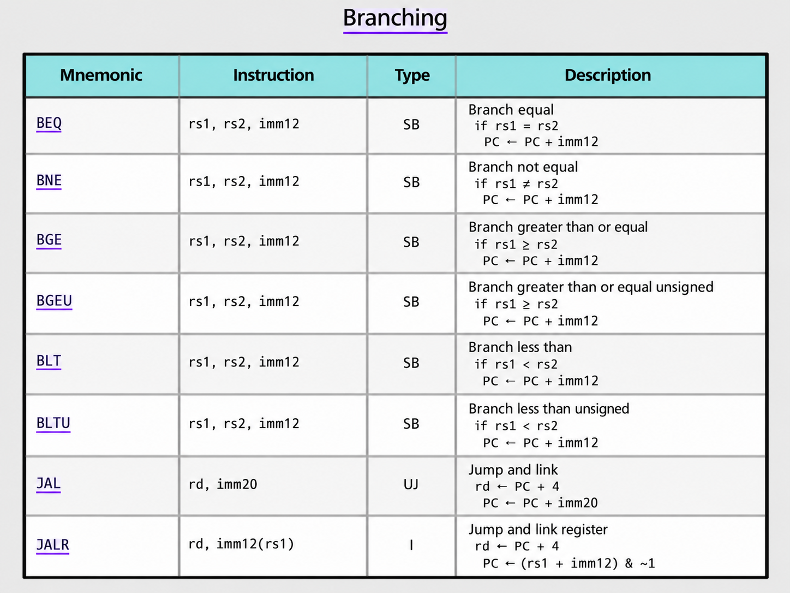](docs/branch_op.png) | [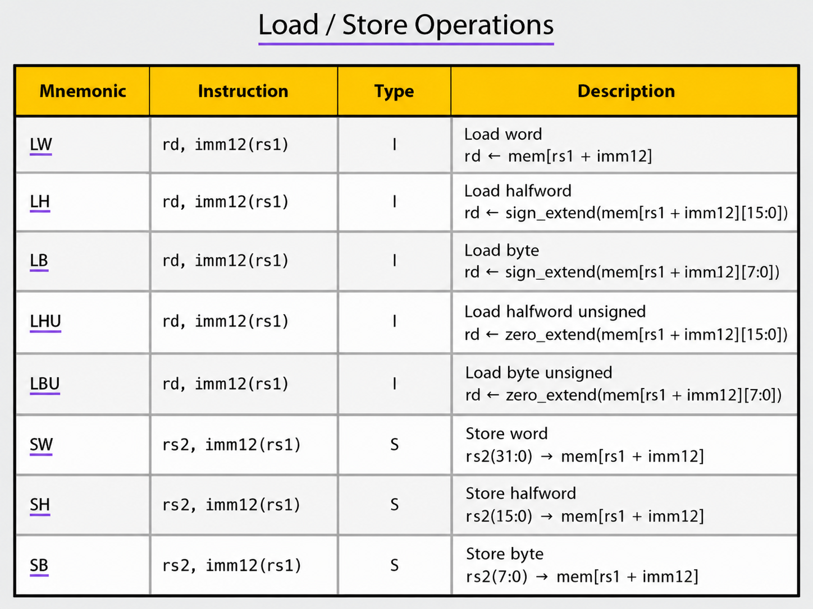](docs/load_store.png) |

### Custom Instructions

The RV32I processor was extended using the RISC-V **`CUSTOM_0` opcode (`0x0B`)**, following the R-type instruction format with two source registers (`rs1`, `rs2`) and one destination register (`rd`).

The `funct3` field determines the custom operation:
- `000`: SIMD SAD4 (implemented).
- `001–111`: Reserved for future extensions.

The `funct7` field is currently unused for custom instruction selection but can support additional operations in the future, allowing further extensions without modifying the 32-bit instruction format.

#### Instruction Example

The following example illustrates the encoding of the implemented SAD4 instruction and its execution through the processor's datapath.

```assembly
# SAD x3, x1, x2
.word 0x0020818B
```
**32-bit Instruction Encoding:**

```text
0000000_00010_00001_000_00011_0001011
                  ↓
         0x0020818B
```
**Instruction Encoding:**

| Bits | Field | Binary | Hex Value | Description |
|---|---|---|---|---|
| `[31:25]` | `funct7` | `0000000` | `0x00` | Unused in current decoding |
| `[24:20]` | `rs2` | `00010` | `0x02` | Second operand (`x2`) |
| `[19:15]` | `rs1` | `00001` | `0x01` | First operand (`x1`) |
| `[14:12]` | `funct3` | `000` | `0x0` | Selects SAD4 |
| `[11:7]` | `rd` | `00011` | `0x03` | Destination register (`x3`) |
| `[6:0]` | `opcode` | `0001011` | `0x0B` | CUSTOM_0 |

**Execution Flow:**

1. **Fetch:** The instruction `0x0020818B` is fetched from Instruction Memory.
2. **Decode:** The `CUSTOM_0` opcode is recognized, and the register addresses and `funct3` field are extracted.
3. **Control:** The Control Unit identifies `funct3 = 000`, selects the SAD operation, and enables register writeback.
4. **Register Read:** The values of `x1` and `x2` are read from the Register File.
5. **Execute:** The ALU activates the SIMD SAD unit, which computes four absolute differences in parallel and sums them.
6. **Writeback:** The 32-bit result is written to register `x3`.


## SIMD SAD4 Implementation

As an example of a custom instruction, the processor implements **SIMD SAD4 (Sum of Absolute Differences)**, using **SIMD (Single Instruction, Multiple Data)** to perform four parallel 8-bit absolute difference calculations within a single instruction. This operation is commonly used in image comparison, block matching, and motion estimation.

Two 32-bit registers each contain four **unsigned 8-bit values**. The dedicated hardware computes four absolute differences **in parallel**:

$$
d_i = |A_i - B_i|, \qquad i = 0,1,2,3
$$

The four differences are then combined using a **two-level adder tree**:

$$
\mathrm{SAD4} = (d_0 + d_1) + (d_2 + d_3)
$$

The first level computes two partial sums in parallel, while the second level combines them into the final result. This balanced structure reduces the addition depth from three stages to two, **minimizing combinational delay** and improving timing efficiency within the single-cycle datapath.

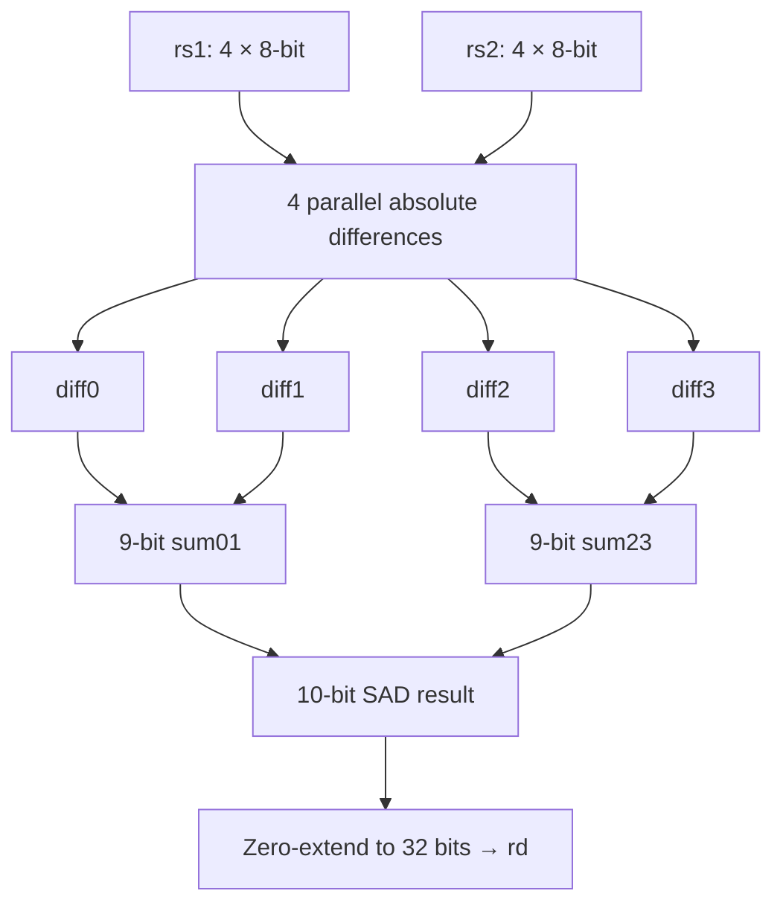

The maximum SAD value is **1020** (`4 × 255`), requiring a 10-bit result before zero-extension to the 32-bit destination register.


## Simulation and Verification

The repository includes three SystemVerilog testbenches for functional verification, along with assembly (`.s`) and machine-code (`.mem`) files for the CPU test programs.

**Before running a CPU testbench, ensure that Instruction Memory is loaded with the corresponding `.mem` file.** The standalone SIMD SAD unit testbench does not require a machine-code file.

### 1. Bubble Sort and Statistics - CPU Test

[`tb_sort_and_statistics.sv`](testbenches/tb_sort_and_statistics.sv) executes the [`Sort and Statistics.s`](testbenches/assembly/Sort%20and%20Statistics.s) program, which sorts eight integers in ascending order and calculates their minimum, maximum, sum, and positive count.

This test demonstrates the processor's ability to execute a complete program involving **nested loops, conditional branches, arithmetic operations, and memory access**, verifying the correct operation of the CPU's datapath and control logic.

<p align="center">
  <a href="docs/sort_statistics_result.png">
    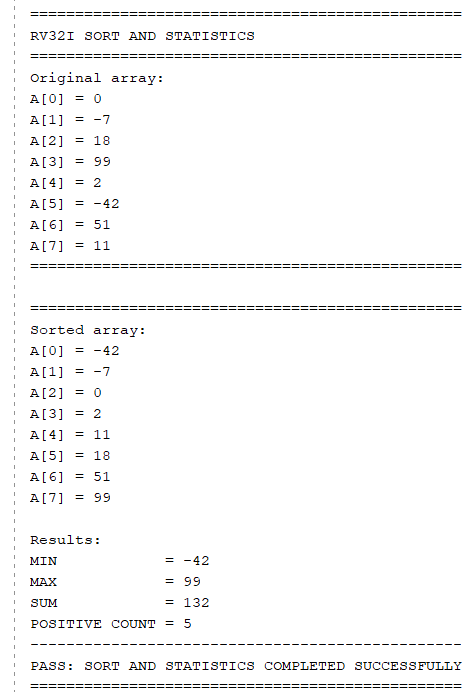
  </a>
</p>

### 2. SIMD SAD4 - standalone unit test

[`tb_simd_sad4.sv`](testbenches/tb_simd_sad4.sv) independently verifies the functionality of the **SIMD SAD4 hardware unit**.
The testbench checks that the unit correctly computes the sum of four absolute differences using five test cases: identical operands, a standard calculation example, maximum differences in both operand orders, and mixed-byte values.

### 3. SAD on the Full CPU - Standard vs. Custom Instruction

[`tb_sad_cpu.sv`](testbenches/tb_sad_cpu.sv) compares two implementations of the same SAD4 calculation: one using standard RV32I instructions and the other using the custom SIMD SAD4 instruction.

Both programs use identical input operands, allowing the testbench to verify the correctness of the results and compare the CPU cycles required by each implementation.

| Standard RV32I Implementation | Custom SIMD SAD4 Instruction |
|:---:|:---:|
| [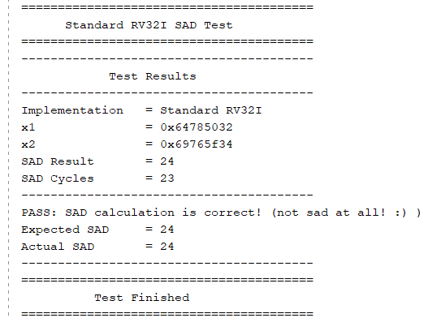](docs/sad_standard_result.png) | [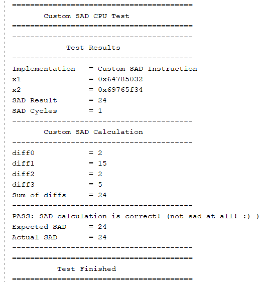](docs/sad_custom_result.png) |
| **23 cycles** | **1 cycle** |

The custom SIMD SAD4 instruction completes the calculation in **a single clock cycle**, compared to **23 clock cycles** using standard RV32I instructions, achieving a **95.7% reduction in cycle count** while producing the same result.

This test demonstrates the processor's ability to **integrate and execute custom instructions within its existing single-cycle datapath**, enabling application-specific hardware acceleration while maintaining correct execution.

**Test Configuration:**
- Set the `USE_CUSTOM_SAD` local parameter in the testbench to select the corresponding measurement configuration.
- Load the matching `.mem` program into Instruction Memory before running the simulation.
- Cycle measurements cover only the SAD calculation, excluding operand initialization.

  
## Implementation and Timing Analysis

Post-implementation Static Timing Analysis (STA) confirmed that the processor successfully meets the **40 MHz clock constraint (25 ns period)**, with positive setup and hold slack and no timing violations on constrained paths.

### Vivado Timing Report

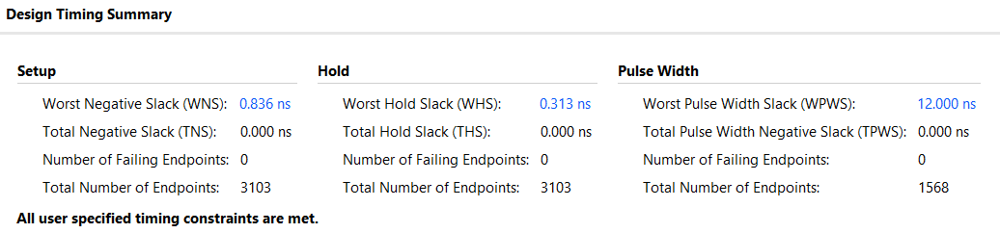

### Timing Results

| Parameter | Result |
|---|---|
| Clock Frequency | **40 MHz** |
| Clock Period | 25.000 ns |
| Worst Negative Slack (WNS) | +0.836 ns |
| Worst Hold Slack (WHS) | +0.313 ns |
| Setup / Hold Violations | 0 |
| Timing Status | **All specified constraints met** |

> **Note:** To support synthesis and timing analysis, debug ports were added to `top.sv` to expose internal signals and prevent the relevant logic from being optimized away. This was necessary to obtain meaningful timing results for the implemented processor.

## Running the Project

**Environment:** Xilinx Vivado with SystemVerilog support. The following instructions describe how to run the project's behavioral simulations.

1. **Add Design Sources:** Add all SystemVerilog files from [`rtl/`](rtl/) to **Design Sources**.
2. **Add Simulation Sources:** Add the testbench files from [`testbenches/`](testbenches/) to **Simulation Sources** and select the appropriate module as the simulation top.
3. **Configure Instruction Memory:** The `Instruction_Memory.sv` module loads its instructions using:

   ```systemverilog
   $readmemh("instruction_memory.mem", memory);
   ```

   Add a file named `instruction_memory.mem` under **Simulation Sources → Memory File** in Vivado.

   Before running a CPU testbench, update this file with the contents of the corresponding `.mem` program listed below.
4. **Configure the SAD CPU Test:** When running `tb_sad_cpu.sv`, set the `USE_CUSTOM_SAD` local parameter to match the selected program:
   - `1'b0` - Standard RV32I SAD implementation.
   - `1'b1` - Custom SIMD SAD4 instruction.
5. **Run the Simulation:** Select **Run Behavioral Simulation** and inspect the simulation console for the test results. Restart the simulation after changing the memory contents or testbench configuration.


| Test | Simulation top | Memory image | Testbench setting |
|---|---|---|---|
| Sort & statistics | `tb_sort_and_statistics` | `sort_and_statistics.mem` | none |
| Standalone SIMD | `tb_simd_sad` | **Not required** | none |
| Standard SAD on CPU | `tb_sad_cpu` | `SAD_Standard.mem` | `USE_CUSTOM_SAD = 1'b0` |
| Custom SAD on CPU | `tb_sad_cpu` | `SAD_Custom.mem` | `USE_CUSTOM_SAD = 1'b1` |

> **Important:** The testbench selection **does not automatically change** which `.mem` file `$readmemh` loads. All supplied memory images contain byte values in little-endian order, one byte per memory entry.


## Repository Structure

```text
RV32I-Single-Cycle-CPU/
├── README.md
├── rtl/
│   ├── top.sv                  
│   ├── rv32i_pkg.sv            
│   ├── fetch.sv
│   ├── Instruction_Memory.sv
│   ├── Decode.sv
│   ├── control.sv
│   ├── register_file.sv
│   ├── alu.sv
│   ├── simd_sad.sv
│   ├── branch_control.sv
│   └── data_memory.sv
├── testbenches/
│   ├── tb_sort_and_statistics.sv
│   ├── tb_simd_sad4.sv
│   ├── tb_sad_cpu.sv
│   ├── assembly/               # Three source programs (.s)
│   └── instruction_memory/     # Three byte-oriented images (.mem)
└── docs/
    ├── rv32i_single_cycle_datapath.png
    ├── rv32i_encoding.jpg
    ├── arithmetic_op.png
    ├── logical_op.png
    ├── branch_op.png
    ├── load_store.png
    ├── sort_statistics_result.png
    ├── sad_standard_result.png
    ├── sad_custom_result.png
    └── timing_summary.png

```

## Summary

This project demonstrates the design and implementation of a **32-bit single-cycle RISC-V processor** in SystemVerilog, supporting arithmetic, logical, memory, and control-flow operations.

The processor was verified through SystemVerilog testbenches, demonstrating its ability to execute complete assembly programs, perform sorting and statistical calculations, and execute custom hardware instructions.

The integration of the **SIMD SAD4 custom instruction** highlights the architecture's extensibility, reducing the computation from **23 clock cycles to a single cycle**, achieving a **95.7% reduction in cycle count** compared to standard RV32I instructions.

Post-implementation timing analysis confirmed that the processor successfully meets the **40 MHz clock constraint**, with positive setup and hold slack and no timing violations on constrained paths.

The processor's modular design provides a foundation for future enhancements, including additional custom instructions and specialized hardware accelerators.


